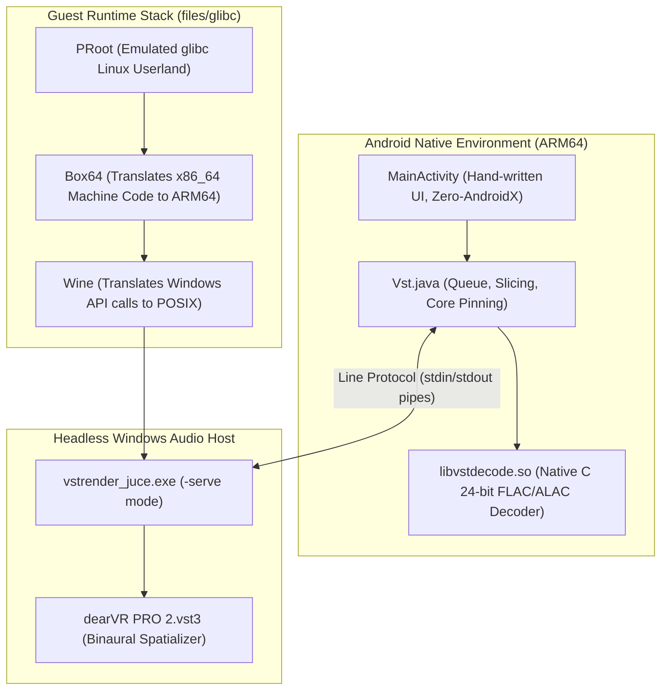
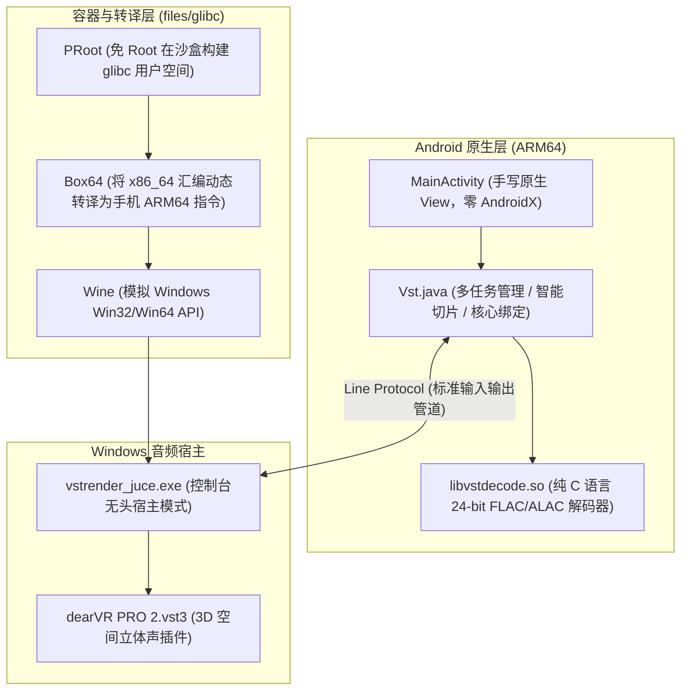

# VST Player

[English](#vst-player) | [中文说明](#vst-player-android-vst3-音频播放渲染器)

---

An Android audio player that renders and plays music **through desktop Windows VST3 plugins** (specifically Sennheiser / Dear Reality's **dearVR PRO 2** 3D spatial audio processor).

It achieves this by running a full multi-tier guest compatibility stack directly inside the Android app's private sandbox:
`PRoot` (glibc rootfs) $\rightarrow$ `Box64` (x86_64 to ARM64 binary translation) $\rightarrow$ `Wine` (Windows API emulation) $\rightarrow$ a lightweight **JUCE VST3 host** (`vstrender_juce.exe`), driven by the Android application over a low-latency line-based IPC protocol.

The release APK is completely self-contained (~280 MB): it carries the compressed guest rootfs, Box64, Wine, and the plugin payload as assets, extracting them on first launch with zero additional downloads required.

> **Download the [latest release](../../releases/latest) only.** `v0.2` and `v0.3` shipped a
> crash — every render of a batch failed, and retrying the batch killed the app with an NPE in
> the engine reader. Both are marked as pre-releases, carry a warning, and are not supported.

```
+-----------------------------------------------------------------------------------+
| Android App (Java / Hand-written Views / targetSdk 28 / No AndroidX)              |
|   |-- Native Decode (libvstdecode.so: 24-bit FLAC/ALAC, bypass platform resample) |
|   |-- Slicing Engine (10m+ audio split into 300s overlapping segments)            |
|   `-- Core Affinity (Taskset helper engines to distinct big cores)                |
+-----------------------------------------------------------------------------------+
                                      |
                      Line Protocol (stdin / stdout)
                                      v
+-----------------------------------------------------------------------------------+
| Guest Compatibility Stack (files/glibc)                                           |
|   PRoot (Glibc sandbox) -> Box64 (x86_64 translator) -> Wine (Win64 API)          |
+-----------------------------------------------------------------------------------+
                                      |
                                      v
+-----------------------------------------------------------------------------------+
| Headless JUCE Host (vstrender_juce.exe -serve)                                    |
|   `-> dearVR PRO 2.vst3 (3D Spatial Audio / Binaural Room Simulation)             |
+-----------------------------------------------------------------------------------+
```

---

## Why This Project Exists

Professional audio production plugins (like 3D binaural spatializers, room acoustics simulators, and analog emulators) are authored exclusively as VST3/CLAP/AU plugins for desktop operating systems (Windows and macOS x86_64/ARM64). Android lacks a standardized native VST3 host ecosystem, and standard mobile players rely on rudimentary system equalizers.

This project bridges that gap by embedding an isolated desktop emulation runtime into Android, allowing high-end studio spatialization algorithms to process mobile audio offline or in parallel.

---

## System Architecture & How It Works

### 1. Execution Flow



### 2. The Line Protocol (IPC Bridge)

The Android frontend controls the background Windows host via textual line commands over standard input/output (`stdin` / `stdout`). Commands are strictly serialized and mapped to wine paths (`Z:\...`):

| Command Sent to Host | Meaning | Expected Host Response |
| :--- | :--- | :--- |
| `READY [ch]` | *Pushed by host on init* | Indicates plugin loaded successfully |
| `PARAMS\|<json>` | Dump all plugin parameters (ID, name, normalized values) | `OK <path>` |
| `GET\|<id>` | Query current value of a parameter knob | `OK <value>\|<text>` |
| `SET\|<id>\|<0..1>` | Adjust a knob (e.g. Azimuth, Elevation, Room Size) | `OK <text>` |
| `PRESET\|<file.vstpreset>` | Load a saved `.vstpreset` configuration | `OK` |
| `SAVE\|<file.vstpreset>` | Persist current parameter state to disk | `OK` |
| `<in.wav>\|<out.wav>` | Process an audio file through the VST3 chain | Series of `PROG <pct>` then `OK` or `ERR` |
| `RESET [hard\|soft]` | Reset all parameters to initial state | `OK` |
| `QUIT` | Gracefully shut down the host process | Process terminates |

### 3. Rendering Pipeline & Optimizations

* **Native Audio Decoder (`libvstdecode.so`)**:
  Android's platform extractor frequently downsamples high-resolution 24-bit audio to 16-bit. A dependency-free C decoder (`dr_flac` + reference ALAC + custom MP4 box parser) ensures bit-exact PCM extraction before rendering.
* **Overlapping Segment Slicing (`Segment.java`)**:
  Files longer than 10 minutes are sliced into 300-second chunks with a 10-second pre-roll. The pre-roll pre-warms plugin internal state (reverbs, delays), and is stripped at concatenation time (`Segment.join`), yielding seamless, sample-exact output without boundary clicks.
* **Multi-Lane Core Pinning (`Vst.java`)**:
  Devices with $\ge$ 6 GB total and $\ge$ 2.6 GB available RAM spawn up to 3 parallel engine instances. Each instance is pinned to distinct performance cores using `taskset` (derived from `cpuinfo_max_freq`), synchronizing parameters across lanes.
* **Delivery Format (`Encode.java`)**:
  The host always writes PCM, so an untouched playlist used to leave dozens of gigabytes of WAV
  behind. Before a render is exported it is compressed to match the source: a lossless source
  (wav / flac / alac / alac-in-m4a / aiff) becomes **FLAC** through the vendored libFLAC encoder
  (bit exact, typically 40-60 % of the WAV), a lossy source (mp3 / aac / ogg / opus) becomes
  **AAC** at the *source* bitrate through the platform encoder plus `MediaMuxer`, and anything
  unknown - including 32 bit PCM, which the platform FLAC decoder cannot read back - stays
  **WAV**. A failed encode always falls back to the WAV it was given: it may cost space, never audio.
* **Safe Exporting (`Export.java`)**:
  Finished renders are written asynchronously to the user's chosen folder through the Storage Access Framework (SAF), with the MIME type matching the delivered container.

---

## Repository Layout

```
android/                  Android application source code
  app/src/main/java/com/vstplayer/
    MainActivity.java     Main window: three tabs (home / library / VST) + detail overlay
    core/                 Audio player, engine manager, decoder bridge, ReplayGain, SAF
    ui/                   Hand-written UI components (zero AndroidX, direct Canvas/View)
  app/src/main/cpp/       Native C ALAC/FLAC/MP4 decoder (libvstdecode.so)
  app/src/standalone/     Target directory for standalone assets (built locally, git-ignored)
juce_renderer/            The headless Windows VST3 host running inside Wine (JUCE C++)
build_payload/            Staging area for packaging the plugin payload archive
third_party/              Vendored JUCE framework (git-ignored)
tools/                    Build scripts, benchmarking suites, and asset splitters
legacy/                   Archived original VST3-SDK host (kept for reference)
docs/                     Architecture specifications, benchmark logs, design history
```

---

## What Is Not in This Repository

This repository contains **source code only**. The following large binary components are omitted from Git:

| Missing Piece | Approximate Size | Why It Is Excluded | How to Obtain It |
| :--- | :--- | :--- | :--- |
| `android/app/src/standalone/assets/` | ~298 MB | Prebuilt rootfs, Wine, Box64, and payload | Extract from the [Release APK](../../releases) or build via `tools/assets/*` |
| `third_party/JUCE` | ~130 MB | Large upstream framework | Clone JUCE and link `juce_renderer/CMakeLists.txt` |
| `dearVR PRO 2.vst3` | ~40 MB | Proprietary plugin binary | Bundled in official Release APKs (see Credits) |

The FLAC encoder is the exception: libFLAC (BSD-3-Clause) is vendored under
`android/app/src/main/cpp/third_party/flac` so a clean clone can build the encoder without any
download. Only the encoder side plus the small decoder the encoder's verify mode links against is
compiled; see [THIRD-PARTY-NOTICES.md](THIRD-PARTY-NOTICES.md) for the license text and the one
local patch applied to it.

---

## Requirements

* **JDK 17** (`JAVA_HOME` properly configured)
* **Android SDK**: Platform 35, Build-Tools, and **NDK 28.2.13676358** (pinned in `app/build.gradle.kts`)
* **CMake 3.22+ & Ninja**: Required for compiling `libvstdecode.so` (picked up automatically via AGP)
* **Target Hardware**: Physical device with `arm64-v8a` architecture and at least 1 GB of free internal storage for the extracted environment

---

## Build and Install

The repository includes Gradle wrapper scripts. `tools/build.sh` manages local builds:

```bash
# Compile debug APK (~280 MB if assets are populated)
tools/build.sh assemble

# Compile and install directly to connected adb device
tools/build.sh install

# Compile gate check only (Java + C++ NDK)
tools/build.sh check

# Target a specific device via wireless adb
DEV=192.0.2.10:5555 tools/build.sh install
```

> [!TIP]
> **Wireless ADB Recommendation**: `tools/build.sh install` utilizes `adb push` + `pm install --user 0` instead of standard `adb install`, preventing network timeouts with ~280 MB APK payloads. On certain OEM ROMs (vivo/iQOO), confirm the installation prompt on the device screen.

---

## Quality Gate & Verification

```bash
# Serialized compile check across parallel editors
tools/gate.sh check

# Verify repository code style (LF, no trailing whitespace, import rules)
python tools/check_style.py

# Measure cold boot latency (process creation -> engine ready)
tools/bench/bootbench.sh 3

# Verify asset decompression throughput
tools/bench/extractbench.sh

# Android Lint static analysis
tools/build.sh lint
```

Refer to `docs/BENCHMARKS.md` for performance baselines across reference devices.

---

## Key Constraints & Design Choices

1. **`minSdk 24` / `targetSdk 28`**:
   Targeting API 28 deliberately bypasses modern Scoped Storage restrictions, granting direct, high-performance filesystem access to music collections without permission overhead.
2. **Zero-AndroidX Hand-Written UI**:
   Every View and layout is hand-coded in pure Java without XML inflation or Jetpack dependencies, minimizing APK overhead, eliminating reachability bloat, and accelerating UI rendering.
3. **Background Power Management**:
   The app acquires a `PARTIAL_WAKE_LOCK` and runs a persistent Foreground Service during batch rendering. Highly aggressive OEM battery savers (ColorOS, OriginOS) may still suspend background processes; configure battery optimization settings manually if freezes occur.

---

## Credits & License

* **dearVR PRO 2**: Developed by [Dear Reality](https://www.dear-reality.com/) (part of Sennheiser Group). Dear Reality discontinued active plugin development in 2025, and Sennheiser released the plugins free of charge without licensing restrictions ([Announcement](https://help.sennheiser.com/hc/en-us/articles/28365062393874-Transition-of-Dear-Reality-Important-Information-for-Existing-Users)). All rights remain with the original rights holders. This repository is an unofficial host created for non-commercial, experimental purposes. If you are a rights holder and request removal, please open an issue for prompt action.
* **Third-Party Open Source**: Box64, PRoot, Wine, JUCE, and `dr_libs` carry their respective open-source licenses; see [THIRD-PARTY-NOTICES.md](THIRD-PARTY-NOTICES.md).
* **Project License**: [GPL-3.0](LICENSE). Bundled third-party binaries are **not** relicensed under GPL-3.0.

---
---

# VST Player (Android VST3 音频播放/渲染器)

[English Version](#vst-player)

---

这是一个让 Android 手机能够**直接运行桌面级 Windows VST3 专业音频效果器**（内置森海塞尔旗下 Dear Reality 公司的 **dearVR PRO 2** 3D 空间音频插件）的高性能音频渲染器与播放器。

通过在 Android 应用私有沙盒内搭建多层运行时转译链路：
`PRoot` (glibc 虚拟环境) $\rightarrow$ `Box64` (x86_64 指令转译至 ARM64) $\rightarrow$ `Wine` (Windows API 模拟层) $\rightarrow$ 轻量级无头 **JUCE VST3 宿主** (`vstrender_juce.exe`)，并通过行级 IPC 管道由 Android 应用进行低延迟精准控制。

发布版 APK 具备完全自包含能力（约 280 MB）：内置 Linux rootfs、Box64、Wine 及插件资源分卷，首次运行时在后台自动解压，无需联网二次下载。

> **只下载[最新发布版](../../releases/latest)。** `v0.2` 与 `v0.3` 都存在闪退缺陷：整批渲染
> 会全部失败，反复重试后 App 因引擎读取线程空指针直接崩溃。这两个版本已标记为 pre-release
> 并加了警告，不再提供支持。

---

## 为什么会有这个项目？

专业音频效果器（如空间音频建模、母带混响、声学模拟）通常仅为 Windows/macOS 桌面平台开发（VST3/CLAP 格式）。移动端 Android 平台缺乏原生专业效果器宿主，普通音乐播放器仅能提供简单的系统级均衡器。

本项目通过在移动端嵌入微型桌面转译运行时，打破了架构与操作系统壁垒，让手机可以随时随地运行顶级桌面效果器，实现高保真空间音频渲染。

---

## 核心架构与运行原理

### 1. 转译调用链与架构图



### 2. 跨进程行协议 (Line Protocol)

Android Java 层与后台 Windows 宿主通过标准输入输出（`stdin`/`stdout`）进行通信。所有指令严格按行收发，路径自动转译为 Wine 盘符（`Z:\...`）：

| 发送给宿主的指令 | 指令含义 | 宿主预期响应 |
| :--- | :--- | :--- |
| `READY [ch]` | *宿主启动完成主动上报* | 表示插件加载就绪 |
| `PARAMS\|<json>` | 请求导出插件所有参数（ID、名称、旋钮归一化值） | `OK <path>` |
| `GET\|<id>` | 读取指定编号旋钮的当前值 | `OK <value>\|<text>` |
| `SET\|<id>\|<0..1>` | 调节指定旋钮（如水平角、仰角、房间尺寸） | `OK <text>` |
| `PRESET\|<file.vstpreset>` | 加载指定的 `.vstpreset` 预设文件 | `OK` |
| `SAVE\|<file.vstpreset>` | 保存当前参数状态至预设文件 | `OK` |
| `<in.wav>\|<out.wav>` | 请求渲染指定音频 | 连续推回 `PROG <pct>` 进度，结束后返回 `OK` 或 `ERR` |
| `RESET [hard\|soft]` | 重置所有旋钮参数至初始状态 | `OK` |
| `QUIT` | 正常终止并退出宿主进程 | 进程安全退出 |

### 3. 音频渲染流程与极致工程优化

* **自研无损 C 解码器 (`libvstdecode.so`)**：
  Android 系统解码器往往会将高规格 24-bit 音频静默降采样至 16-bit。项目内置无外部依赖的 C 语言解码器（集成 `dr_flac`、官方 ALAC 解码与精简 MP4 解析），实现位完美（bit-exact）的高解析度音频直通。
* **带预热缓冲的切片机制 (`Segment.java`)**：
  对超过 10 分钟的长音频进行分段（300 秒切片 + 10 秒 pre-roll 预热）。预热区能提前激活空间音频混响和延迟尾音，在合并阶段（`Segment.join`）无缝剥离，彻底消除切片边缘的爆音与相位断层。
* **多核调度与进程绑核 (`Vst.java`)**：
  在总内存 $\ge$ 6 GB 且可用内存 $\ge$ 2.6 GB 的设备上，自动拉起多达 3 个辅助渲染引擎。利用 `taskset` 将每个进程硬绑定至高频 CPU 大核（通过读取 `cpuinfo_max_freq` 决定），并在多进程间毫秒级同步 36 个控制参数。
* **异步安全导出 (`Export.java`)**：
  渲染完毕的 WAV 文件由专用导出线程通过 Android 存储访问框架 (SAF) 写入指定外部目录，保障 UI 主线程绝对流畅。

---

## 目录结构说明

```
android/                  Android 客户端代码
  app/src/main/java/com/vstplayer/
    MainActivity.java     三 Tab 页面（主页 / 媒体库 / VST 调控）与悬浮详情页
    core/                 播放器核心、引擎管理、解码中继、ReplayGain 响度、SAF 文件管理
    ui/                   全手写 UI 视图组件（无 AndroidX，底层 Canvas/View 纯代码实现）
  app/src/main/cpp/       原生 C 语言 ALAC/FLAC/MP4 解码库 (libvstdecode.so)
  app/src/standalone/     独立安装包资源资产目录（本地生成，不入 Git 仓库）
juce_renderer/            运行在 Wine 容器内部的 JUCE Windows VST3 无头宿主程序
build_payload/            插件包归档制作与暂存区
third_party/              引用的第三方 JUCE 框架源码（Git 忽略）
tools/                    构建工具、基准性能测试与资产分卷脚本
legacy/                   旧版 VST3-SDK 宿主（仅供架构参考归档）
docs/                     系统架构白皮书、性能评测基准、演进历史报告
```

---

## 为什么源码仓库缺少部分文件？

本仓库**仅提供核心源码**。以下超大体积的运行环境与第三方二进制文件未提交至 Git：

| 缺失组件 | 大小估算 | 排除原因 | 获取与补齐方案 |
| :--- | :--- | :--- | :--- |
| `android/app/src/standalone/assets/` | 约 298 MB | 预构建 rootfs、Wine、Box64 二进制体积过大 | 从 [Release 发布页](../../releases) 下载已打包的 APK 提取，或运行 `tools/assets/*` 自行分卷 |
| `third_party/JUCE` | 约 130 MB | 第三方开源大型音频框架 | 自行 Clone JUCE 并配置 `juce_renderer/CMakeLists.txt` |
| `dearVR PRO 2.vst3` | 约 40 MB | 厂商专有效果器二进制 | 官方 Release 发布包已内置（详见致谢说明） |

---

## 开发与构建环境要求

* **JDK 17**（需配置 `JAVA_HOME`）
* **Android SDK**：包含 Platform 35、Build-Tools 及 **NDK 28.2.13676358**（在 `app/build.gradle.kts` 中严格锁定）
* **CMake 3.22+ 与 Ninja**：用于原生 C 解码器编译（AGP 自动从 Android SDK 拾取）
* **测试真机**：`arm64-v8a` 架构设备，且留有至少 1 GB 剩余存储空间用于解压环境

---

## 编译与安装指南

项目已签入 Gradle Wrapper，日常编译推荐使用 `tools/build.sh`：

```bash
# 编译 Debug 版 APK（在已补全 assets 前提下约 280 MB）
tools/build.sh assemble

# 编译并推送到连接的 ADB 目标设备完成安装
tools/build.sh install

# 仅执行编译质量门禁（Java + 原生 C++ NDK 编译检查）
tools/build.sh check

# 指定无线调试设备地址进行部署
DEV=192.0.2.10:5555 tools/build.sh install
```

> [!TIP]
> **无线调试部署提示**：针对约 280 MB 的大尺寸 APK，`tools/build.sh install` 采用 `adb push` + `pm install --user 0` 组合方案，避免常规 `adb install` 在大文件无线传输时的连接中断。部分机型（如 vivo/iQOO）需在屏幕上手动确认安装许可。

---

## 质量验证与基准测试

```bash
# 执行并发互斥编译门禁检查
tools/gate.sh check

# 校验全库代码风格（统一 LF 换行、禁止尾随空格与通配符导入）
python tools/check_style.py

# 评测冷启动性能（从进程创建到引擎 Ready 耗时，参考标准 ~3.7s）
tools/bench/bootbench.sh 3

# 评测首发解包资产释放速率
tools/bench/extractbench.sh

# 生成 Android Lint 静态分析报告
tools/build.sh lint
```

详细性能标准指标及各机型耗时基线参见 `docs/BENCHMARKS.md`。

---

## 核心设计约束与工程权衡

1. **保留 `targetSdk 28` 的考量**：
   应用锁定 Android 9 (API 28)，故意规避后续 Android 版本中强制启用的 Scoped Storage 分区存储限制，保证对海量本地高解析度音乐的零延迟遍历与极速读取。
2. **纯原生手写 View 与零依赖**：
   摒弃 AndroidX 与 Jetpack，全界面由纯 Java 代码绘制，彻底杜绝方法数膨胀与间接依赖开销，确保在底层密集转译音频时 UI 依然能够保持丝滑流畅。
3. **后台电源管理与保活**：
   离线分段批量渲染期间，应用会常驻前台服务（Foreground Service）并持有 `PARTIAL_WAKE_LOCK`。因部分厂商定制系统（如 ColorOS、OriginOS 等）具有激进的后台进程查杀策略，若遇到渲染停滞，建议在系统设置中将本应用加入“后台高耗电允许”白名单。

---

## 致谢与版权许可

* **dearVR PRO 2**：由 [Dear Reality](https://www.dear-reality.com/)（森海塞尔集团成员）研发。Dear Reality 已于 2025 年停止该产品线的商业维护，森海塞尔官方现已面向公众免费提供该插件全量功能且无需任何授权激活（[官方公告](https://help.sennheiser.com/hc/en-us/articles/28365062393874-Transition-of-Dear-Reality-Important-Information-for-Existing-Users)）。插件所有知识产权归原权利人所有。本项目仅作为非商业性质的实验性技术宿主，在发布的 Release APK 中内置该免费插件以便开箱即用。**如权利人认为涉及侵权并要求移除，请提 Issue，项目维护者将第一时间响应下架处理。**
* **第三方开源组件**：Box64、PRoot、Wine、JUCE 及 `dr_libs` 分别遵循各自独立的开源许可协议，详见 [THIRD-PARTY-NOTICES.md](THIRD-PARTY-NOTICES.md)。
* **项目开源许可证**：[GPL-3.0](LICENSE)。内置打包的第三方二进制文件**不受**本项目的 GPL 协议再许可约束。
